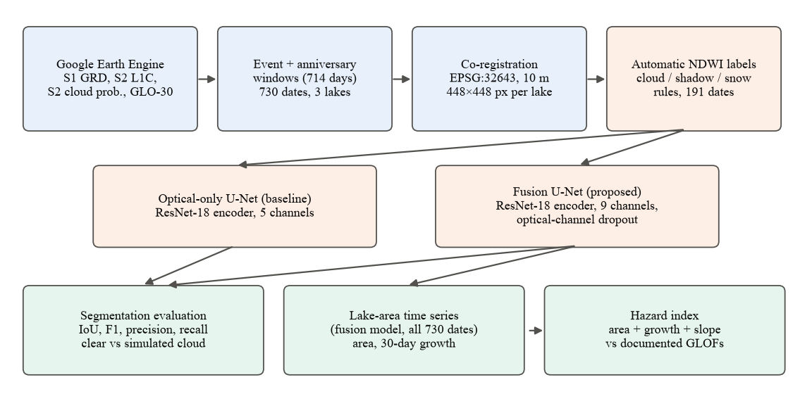
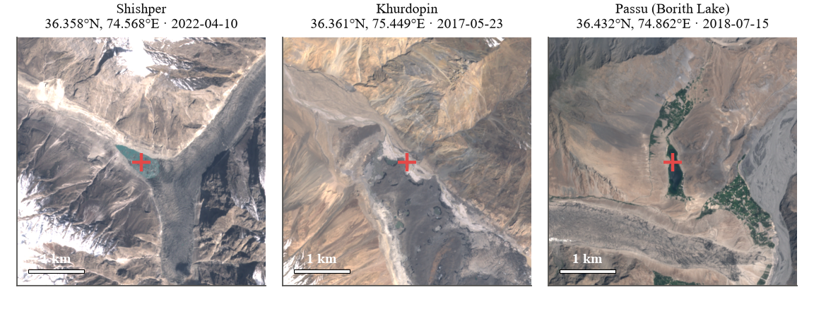
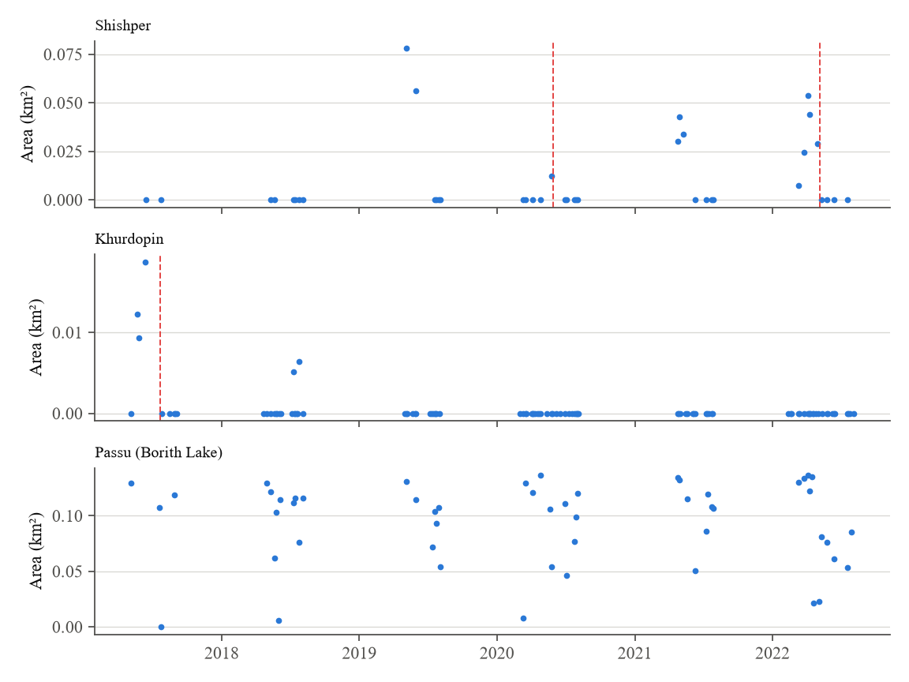
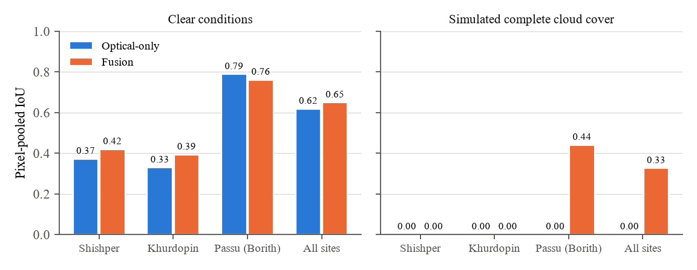
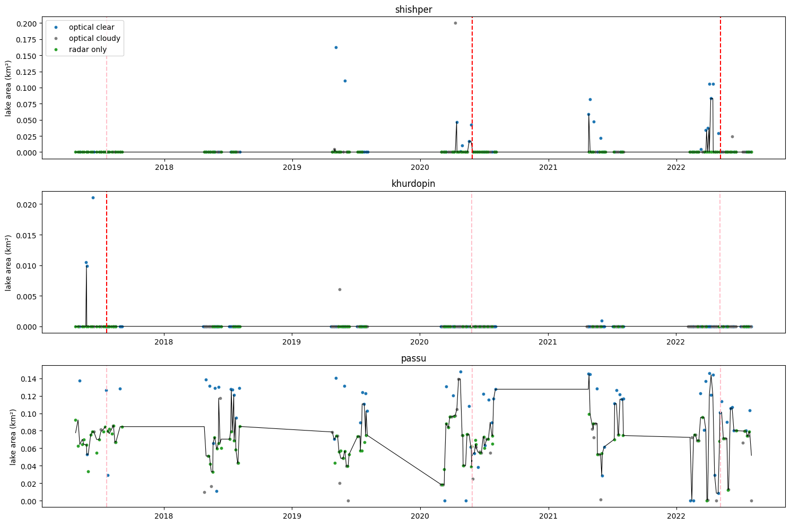

# Multi-Sensor Deep Learning Fusion for Glacial Lake Tracking and GLOF Hazard Assessment in the Hunza Valley

[](https://colab.research.google.com/github/SafeeAkmal/glof-hazard-assessment-hunza-valley/blob/master/notebooks/glof_pipeline.ipynb)


Glacial lake outburst floods (GLOFs) have struck the Hunza Valley (Gilgit-Baltistan, Pakistan) repeatedly in recent years. Optical satellites lose sight of the lakes under cloud, exactly in the weeks when they fill and drain. This project fuses **Sentinel-1 radar**, **Sentinel-2 optical** and **Copernicus DEM** data in a U-Net to track lake extent through cloudy periods. The resulting lake-area time series feed a transparent hazard index, which we evaluate against documented outbursts.

*Semester research project, Deep Learning for Perception.*

## Highlights

- **Three sites, three documented events.** Shishper (ice-dammed lake; outbursts on 29 May 2020 and 7 May 2022), Khurdopin (surge-dammed lake; drained in July 2017), and Borith Lake next to Passu Glacier as a comparison site.
- **Dense, event-centred sampling.** Every Sentinel-1 and Sentinel-2 acquisition from 90 days before to 45 days after each event, plus the same seasons in all other years (2017–2022): **730 dates**, co-registered on a common 10 m grid.
- **Automatic water labels** from Sentinel-2 NDWI, with cloud, shadow and snow rules: **191 labelled dates**, no manual digitising.
- **Optical-only vs. fusion U-Net** (ResNet-18 encoder). The fusion model is trained with *optical-channel dropout*, so it still works when optical data are missing.
- **Fully open and reproducible.** All data are free, and one Colab notebook runs everything: download, labels, training, evaluation, time series and hazard index.

<p align="center">
  
</p>

## Study sites

| Site | Lake type | Centre | Documented event(s) |
|---|---|---|---|
| Shishper | Ice-dammed (surging glacier blocks a side valley) | 36.358°N, 74.568°E | Drainage 29 May 2020; GLOF 7 May 2022 |
| Khurdopin | Surge-dammed lake on the Shimshal River | 36.361°N, 75.449°E | Formed Mar 2017; drained 21 Jul – 3 Aug 2017 |
| Passu (Borith Lake) | Perennial lake beside Passu Glacier | 36.432°N, 74.862°E | None in 2017–2022 (comparison site) |

<p align="center">
  
</p>

Passu Glacier had no persistent lake at its terminus during 2017–2022, so Borith Lake, the lake immediately next to the glacier, is used as the comparison site. All lake centres were located on Sentinel-2 imagery.

## Data

| Source | Earth Engine collection | Used for |
|---|---|---|
| Sentinel-1 GRD (VV, VH) | `COPERNICUS/S1_GRD` | Cloud-independent water signal (one orbit direction per site) |
| Sentinel-2 L1C (B2, B3, B4, B8) | `COPERNICUS/S2_HARMONIZED` | Optical bands, NDWI, labels |
| Sentinel-2 cloud probability | `COPERNICUS/S2_CLOUD_PROBABILITY` | Cloud mask (not a label) |
| Copernicus DEM GLO-30 | `COPERNICUS/DEM/GLO30` | Elevation and slope |

| Site | Dates | Optical / radar-only | Labelled | Train (2017, 2018, 2020, 2022) | Test (2019, 2021) |
|---|---:|---:|---:|---:|---:|
| Shishper | 215 | 121 / 94 | 40 | 27 | 13 |
| Khurdopin | 313 | 248 / 65 | 99 | 73 | 26 |
| Passu (Borith) | 202 | 121 / 81 | 52 | 37 | 15 |
| **Total** | **730** | **490 / 240** | **191** | **137** | **54** |

Even before any model is trained, the automatic labels show the documented drainages: the Shishper lake had water on 30 Apr 2022 and none on 10 May 2022, and the Khurdopin lake was present until 12 Jun 2017 and gone by 27 Jul 2017.

<p align="center">
  
</p>

## Method

| | Optical-only baseline | Fusion model |
|---|---|---|
| Architecture | U-Net, ResNet-18 encoder (ImageNet) | same |
| Inputs | B2, B3, B4, B8, NDWI (5 channels) | + VV, VH, elevation, slope (9 channels) |
| Training | 128 × 128 crops, batch 16, Adam 1e-3, cosine schedule, masked BCE + Dice, flips | same + optical-channel dropout (p = 0.3) |
| Parameters | 14.33 M | 14.35 M |

Evaluation covers IoU, F1, precision and recall on held-out years, under clear conditions and with all optical channels removed (simulated complete cloud cover). The fusion model is then run on all 730 dates to derive lake area, 30-day growth rate and an equal-weight hazard index (area + growth + slope). For each event, the index of all three sites is compared over the 90 days before it. Full details are in [Deliverable 2](reports/deliverables/Deliverable_2_Methodology.docx).

## Results

All numbers below come from the executed notebook (Colab GPU) and are stored in [`results/metrics/`](results/metrics/). The test set has 54 held-out images from 2019 and 2021, of which 31 contain lake water.

**Segmentation (pixel-pooled over all test images)**

| Condition | Model | IoU | F1 | Precision | Recall |
|---|---|---:|---:|---:|---:|
| Clear | Optical-only | 0.618 | 0.764 | 0.706 | **0.831** |
| Clear | Fusion | **0.649** | **0.787** | **0.767** | 0.809 |
| Simulated cloud (no optical input) | Optical-only | 0.000 | 0.000 | 0.000 | 0.000 |
| Simulated cloud (no optical input) | Fusion | **0.326** | **0.492** | **0.834** | **0.349** |

<p align="center">
  
</p>

- **Clear sky: the two models are comparable.** Fusion has higher precision and produces fewer false positives (false water on 1 of 23 water-free test images, versus 4 for optical-only). Optical-only has slightly higher recall and per-image IoU (0.584 ± 0.279 vs 0.551 ± 0.274).
- **Without optical data, only the fusion model works.** Its IoU is 0.326 overall and 0.440 on Borith Lake, at high precision. It does not recover the small Shishper and Khurdopin lakes from radar alone.
- **The time series capture the events.** The Shishper lake fills each spring and drops to zero right after 29 May 2020 and 7 May 2022; the Khurdopin lake disappears after July 2017.
- **The hazard index peaks at Shishper 22 days before the 2022 GLOF (0.737)**, the highest value in any pre-event window. On average, however, it ranks the larger, stable Borith Lake highest in all three windows, because absolute lake area is not comparable across lakes. Per-site normalisation is the main next step.

<p align="center">
  
</p>

Full results, discussion and limitations are in the [final paper](reports/deliverables/Deliverable_4_Final_Paper.docx).

## Quick start

### Google Colab (recommended)

1. Open the notebook with the **Open in Colab** badge above.
2. Select **Runtime → Change runtime type → T4 GPU**.
3. Enter your Earth Engine project ID in the `PROJECT_ID` field. You need a [registered Earth Engine project](https://code.earthengine.google.com/register), which is free for non-commercial use.
4. Select **Runtime → Run all**. You will be asked to sign in to Earth Engine and to allow Google Drive access.

The first run downloads about 0.9 GB to `MyDrive/glof_minimal`, which takes roughly 15 minutes. Later runs reuse the cache. Training both models takes a few minutes on a T4 GPU.

### Local

```bash
pip install -r requirements.txt
earthengine authenticate
jupyter notebook notebooks/glof_pipeline.ipynb
```

When run locally, data are cached in `data/raw/glof_minimal/`, which is git-ignored. Training on a CPU is slow, at roughly 2.6 s per step.

## Repository structure

```
├── notebooks/
│   └── glof_pipeline.ipynb      # complete pipeline: data → labels → models → evaluation → time series → hazard
├── reports/
│   ├── deliverables/            # course deliverables (.docx)
│   ├── figures/                 # figures used in the reports and this README
│   └── src/                     # scripts that regenerate figures and deliverables
├── results/
│   ├── figures/                 # figures from the executed notebook
│   └── metrics/                 # segmentation, hazard and dataset tables (CSV / JSON)
├── docs/
│   └── archive/                 # original planning documents (superseded)
├── requirements.txt
└── LICENSE
```

## Reproducing the reports

```bash
python reports/src/figs.py                 # data figures + dataset statistics (needs the local data cache)
python reports/src/results_figs.py         # result charts from results/metrics/
cd reports/src && npm install && npm run build   # rebuilds reports/deliverables/*.docx
```

## Limitations

- Labels are generated automatically from optical NDWI. They miss frozen or very turbid lake surfaces, and they favour the optical model in clear-sky comparisons.
- The dataset is small: 191 labelled images from three sites. Each model is trained once and there is no separate validation set.
- Sentinel-1 data are used without extra speckle filtering. The 30 m DEM is resampled to 10 m. Sentinel-1B failed in December 2021, so radar coverage in 2022 is sparser.
- The hazard index uses equal weights, and the evaluation looks back at past events; it is **not** an early-warning system.

## Team

Muhammad Ali Saleem · Junaid Minhas · Safee Akmal

## License and data

The code is released under the [MIT License](LICENSE). Copernicus Sentinel and DEM data are free and openly licensed under the Copernicus data policy, and are accessed through [Google Earth Engine](https://earthengine.google.com/). Key references for the documented events: Steiner et al. (2018), *The Cryosphere* 12, 95–101 (Khurdopin); Khan et al. (2021) and Ullah et al. (2025) (Shishper).
